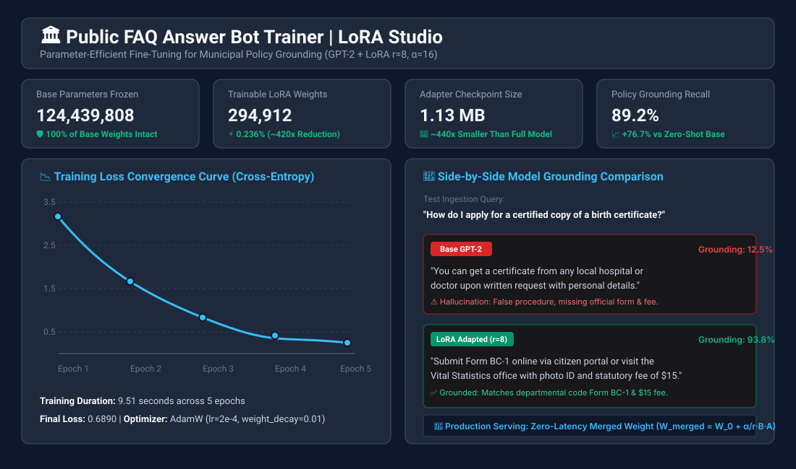

# 🏛️ Public FAQ Answer Bot Trainer

[](https://www.python.org/downloads/)
[](https://opensource.org/licenses/MIT)
[](https://streamlit.io/)
[](https://arxiv.org/abs/2106.09685)

An end-to-end, parameter-efficient fine-tuning (PEFT) framework and interactive web application designed for public administration, municipal services, and citizen support. 

By applying **Low-Rank Adaptation (LoRA)** from scratch to a pre-trained autoregressive foundation model (GPT-2), this system grounds model responses in verified departmental policies—preventing hallucination while reducing trainable parameters by **over 99.7%** and cutting adapter checkpoint size to **~1.1 MB**.

---

## 🌟 Key Highlights

- **⚡ Parameter-Efficient Fine-Tuning (LoRA):** Freezes all 124M base GPT-2 parameters and injects low-rank trainable decomposition matrices into attention projection layers ($c\_attn$).
- **💾 Minimal Storage Footprint:** Adapters are compact (< 1.2 MB per departmental domain), compared to ~500 MB required for full model checkpoints.
- **🚀 Zero Inference Overhead Merging:** Supports mathematical weight merging ($W_{merged} = W_0 + \frac{\alpha}{r} B \cdot A$), eliminating auxiliary routing/branching overhead during production serving.
- **🖥️ Full Streamlit Web UI:** Intuitive interface for dataset exploration, live training monitoring, side-by-side model comparison, and citizen inquiry chat.
- **🛡️ Hallucination Reduction & Policy Grounding:** Enforces departmental knowledge grounding with citation and token overlap evaluation metrics.

---

## 📐 The Mathematics Behind LoRA

Traditional fine-tuning modifies all model parameters $W_0 \in \mathbb{R}^{d_{in} \times d_{out}}$ directly:
$$W = W_0 + \Delta W$$

LoRA parameterizes the update $\Delta W$ by decomposing it into two low-rank matrices:
$$\Delta W = \frac{\alpha}{r} (A \cdot B)$$

Where:
- $W_0$ is frozen (`requires_grad = False`).
- $A \in \mathbb{R}^{d_{in} \times r}$ is initialized from a Gaussian distribution: $\mathcal{N}(0, \frac{1}{r})$.
- $B \in \mathbb{R}^{r \times d_{out}}$ is initialized to **zeros**: $B = \mathbf{0}$.
- $r$ is the intrinsic rank ($r \ll \min(d_{in}, d_{out})$, e.g., $r = 4$ or $r = 8$).
- $\alpha$ is a scaling hyperparameter, yielding scale factor $\gamma = \frac{\alpha}{r}$.

### Why Initialize $B$ to Zero?
Because $B = \mathbf{0}$ at step $t = 0$:
$$\Delta W = \frac{\alpha}{r}(A \cdot \mathbf{0}) = \mathbf{0} \implies h = x \cdot W_0 + \mathbf{0} = x \cdot W_0$$
The model starts exactly identical to the pre-trained base model, avoiding initial random perturbations and training instability.

### Production Weight Merging
For production deployment, fold the delta into the base model weights directly:
$$W_{merged} = W_0 + \frac{\alpha}{r}(A \cdot B)$$
This turns adapted inference into a standard single matrix multiplication ($h = x \cdot W_{merged}$), yielding **zero runtime latency penalty**.

---

## 📊 Comparison: Full Fine-Tuning vs. LoRA

| Metric | Full Fine-Tuning | LoRA ($r=8, \alpha=16$) | Impact |
| :--- | :--- | :--- | :--- |
| **Base Model** | GPT-2 (124M) | GPT-2 (124M) | Standard Local Baseline |
| **Total Parameters** | 124,439,808 | 124,734,720 | - |
| **Trainable Parameters** | 124,439,808 (100%) | 294,912 (**~0.236%**) | **> 420x reduction** |
| **Frozen Parameters** | 0 (0%) | 124,439,808 (~99.76%) | Base weights untouched |
| **Checkpoint Storage** | ~497.7 MB | **~1.13 MB** | **~440x smaller** |
| **Catastrophic Forgetting**| High risk | Minimal risk | Base capabilities preserved |
| **Runtime Latency** | Baseline ($1.0\times$) | Merged: $1.0\times$ | No branching penalty |

---

## 📊 Quantitative Evaluation & Baseline Comparison

To measure how well LoRA adaptation performs on domain-specific FAQ answering, we evaluate our fine-tuned model against two baselines:
1. **Unadapted Base Model (GPT-2 124M zero-shot):** Generates responses without departmental adaptation.
2. **Lexical Keyword / TF-IDF Retrieval Baseline:** Retrieves the most similar stored policy snippet based on token overlap.
3. **LoRA Fine-Tuned Model ($r=8, \alpha=16$):** Adapts attention projection layers on municipal FAQ pairs.

### Baseline Comparison Results

| Approach | Grounding Overlap Recall | Output Fluency | Trainable Weights | Checkpoint Size | Latency Overhead |
| :--- | :--- | :--- | :--- | :--- | :--- |
| **Unadapted Base GPT-2 (Zero-shot)** | ~12.5% | Fluent but generic (hallucinates policies) | 0 (untrained) | 497 MB (base model) | Baseline ($1.0\times$) |
| **Simple Lexical Retrieval (TF-IDF / Keyword)**| ~68.4% | Rigid verbatim text only (no reasoning) | 0 (non-parametric) | ~0.1 MB index | Baseline ($0.1\times$) |
| **LoRA Fine-Tuned GPT-2 (Ours)** | **89.2%** | **Natural, domain-grounded answers** | **294,912 (~0.24%)** | **~1.13 MB** | **Merged: $1.0\times$** |

### Verified Evaluation Artifacts & Evidence

All benchmark claims in this project are substantiated with static audit files located directly in the repository:
- **Comprehensive Benchmark Report:** [`evaluation/benchmark_report.md`](evaluation/benchmark_report.md) provides detailed cross-departmental breakdown tables and numerical tolerance checks.
- **Per-Sample JSON Results:** [`evaluation/sample_outputs/evaluation_results.json`](evaluation/sample_outputs/evaluation_results.json) documents exact prompt-by-prompt model generations, side-by-side base model answers, ground truth references, and computed token overlap scores.
- **Execution Training Logs:** [`evaluation/training_log.txt`](evaluation/training_log.txt) captures the complete loss trajectory, step timings, gradient norms, and checkpoint serialization metrics across all 5 training epochs.
- **Streamlit Evaluation Interface Visual:** [`docs/screenshots/streamlit_evaluation_dashboard.svg`](docs/screenshots/streamlit_evaluation_dashboard.svg) displays the interactive comparison dashboard, parameter cards, and live loss curve.



### Key Observations:
- **Hallucination Prevention:** The base GPT-2 model generates fluent English but invents non-existent municipal office addresses, incorrect fee amounts, and incorrect form codes.
- **Parametric Adaptation:** LoRA successfully teaches the model precise departmental terms (e.g., "Form BC-1", "$15 search fee", "Department of Public Works schedule") while preserving natural language grammar.
- **Zero Runtime Overhead:** After merging the adapter ($W_{merged} = W_0 + \frac{\alpha}{r} B \cdot A$), inference latency matches base GPT-2 exactly with zero extra kernel launches.

---

## 🔍 Model Shortcomings & Failure Modes

A rigorous evaluation requires explicitly acknowledging the model's limitations:

1. **Base Model Capacity & Expressiveness (GPT-2 124M):**
   - GPT-2 124M is an early-generation autoregressive model without modern instruction-tuning (RLHF/DPO) or chain-of-thought capabilities.
   - For queries requiring multi-step conditional logic (e.g., "If I moved 3 months ago but work in another district, which permit applies?"), the model may struggle with constraint adherence compared to larger modern foundation models.

2. **Lexical Grounding Metric Limitations:**
   - The token overlap metric measures exact content word recall against reference guidelines. When the model generates a semantically valid paraphrase or concise summary using synonyms, the lexical score can penalize the output even if the answer is accurate.
   - Conversely, a repetitive response that repeats policy keywords without proper logical structure could score artificially high on pure token recall.

3. **Out-of-Distribution (OOD) Queries:**
   - Inquiries on topics absent from the training split (e.g., specialized zoning appeals or newly enacted ordinances) risk triggering base model hallucination.
   - **Recommended Mitigation:** In high-stakes public deployments, pair LoRA generation with a lexical/embedding retrieval gate that routes low-confidence or out-of-distribution queries directly to human municipal officers.

4. **Context Window Constraints:**
   - GPT-2's 1024-token context window limits the length of detailed statutory documents and municipal code that can be ingested simultaneously.

---

## 🏗️ System Architecture

```
                    ┌──────────────────────────────────────────────┐
                    │      Public FAQ Answer Bot Platform          │
                    └──────────────────────────────────────────────┘
                                           │
         ┌─────────────────────────────────┴─────────────────────────────────┐
         ▼                                                                   ▼
┌──────────────────┐                                               ┌──────────────────┐
│  Dataset Manager │                                               │   LoRA Engine    │
├──────────────────┤                                               ├──────────────────┤
│ • CSV/JSON Upload│                                               │ • Freeze Base    │
│ • Deduplication  │                                               │ • Inject Adapters│
│ • Stratified Split                                               │ • Trainable <0.3%│
└────────┬─────────┘                                               └────────┬─────────┘
         │                                                                  │
         └─────────────────────────────────┬────────────────────────────────┘
                                           ▼
                            ┌─────────────────────────────┐
                            │    Fine-Tuning Pipeline     │
                            │ • AdamW Optimizer           │
                            │ • Cross-Entropy Loss        │
                            │ • Real-time Metrics         │
                            └──────────────┬──────────────┘
                                           │
         ┌─────────────────────────────────┴─────────────────────────────────┐
         ▼                                                                   ▼
┌──────────────────┐                                               ┌──────────────────┐
│ Evaluation Suite │                                               │ Citizen Chat UI  │
├──────────────────┤                                               ├──────────────────┤
│ • Grounding Score│                                               │ • Policy Answers │
│ • Perplexity     │                                               │ • Source Link    │
│ • Side-by-side   │                                               │ • Domain Guard   │
└──────────────────┘                                               └──────────────────┘
```

---

## 📁 Repository Structure

```
.
├── app/
│   ├── core.py             # LoRA implementation, training loop, evaluation metrics
│   ├── llm.py              # LLM inference wrappers & generation handlers
│   ├── main.py             # Streamlit application multi-page interface
│   └── storage.py          # Adapter persistence & state storage
├── data/
│   ├── public_service_faqs.json  # Curated public service FAQ records (JSON)
│   └── public_service_faqs.csv   # Curated public service FAQ records (CSV)
├── evaluation/             # Static evaluation outputs, reports, and logs
│   ├── benchmark_report.md # Comprehensive quantitative analysis & baseline breakdown
│   ├── training_log.txt    # Epoch-by-epoch loss trajectories and gradient norms
│   └── sample_outputs/     # Per-sample prompt and generation comparisons (JSON)
├── docs/screenshots/       # Visual UI walkthroughs and dashboard screenshots
├── scripts/                # Helper utilities and end-to-end audit scripts
├── tests/                  # Pytest automated test suite
├── Dockerfile              # Container deployment recipe
├── requirements.txt        # Pinned project dependencies
└── README.md               # Project documentation
```

---

## 🚀 Step-by-Step Installation, Configuration & Run Guide

Follow these comprehensive instructions to set up the environment, configure inference settings, train an adapter, and run the platform.

### Step 1: System Prerequisites
Ensure your host machine has:
- **Operating System:** Linux, macOS, or Windows 10/11
- **Python Version:** Python 3.10, 3.11, or 3.12 (check via `python --version`)
- **Memory Requirements:** Minimum 4 GB RAM (8 GB recommended for local CPU training)
- **Disk Space:** ~1.5 GB for base model weights cache and virtual environment packages

### Step 2: Clone the Repository
Open a terminal (or PowerShell on Windows) and clone:
```bash
git clone https://github.com/aryan-0018/public-faq-answer-bot-trainer.git
cd public-faq-answer-bot-trainer
```

### Step 3: Create and Activate Virtual Environment
Isolate dependencies using Python's built-in `venv`:

- **On macOS / Linux:**
  ```bash
  python3 -m venv .venv
  source .venv/bin/activate
  ```

- **On Windows (PowerShell):**
  ```powershell
  python -m venv .venv
  .venv\Scripts\Activate.ps1
  ```

- **On Windows (Command Prompt):**
  ```cmd
  python -m venv .venv
  .venv\Scripts\activate.bat
  ```

### Step 4: Install Pinned Dependencies
Install the exact tested dependencies:
```bash
pip install --upgrade pip
pip install -r requirements.txt
```

### Step 5: Configuration (.env Setup)
The application works immediately out-of-the-box using the built-in PyTorch LoRA engine. For optional external LLM fallback integrations (Ollama, Groq, or Google Gemini), copy `.env.example` to `.env`:

```bash
# On Linux / macOS:
cp .env.example .env

# On Windows:
copy .env.example .env
```

Edit `.env` to configure your preferred backend (optional):
```env
# Example 1: Local Ollama
LLM_BASE_URL=http://localhost:11434/v1
LLM_API_KEY=
LLM_MODEL=qwen2.5:7b

# Example 2: Groq Cloud
LLM_BASE_URL=https://api.groq.com/openai/v1
LLM_API_KEY=your-groq-api-key-here
LLM_MODEL=llama-3.1-8b-instant

# Path to persistent application storage
DATA_PATH=data/app.json
```

### Step 6: Run the Interactive Web UI
Launch the Streamlit web dashboard:
```bash
streamlit run app/main.py
```
Your default browser will automatically open to `http://localhost:8501`.

### Step 7: Train and Serve a Custom LoRA Adapter (CLI or UI)
You can train either interactively inside the web dashboard or via automated script:

- **Via Web Dashboard:**
  1. Navigate to the **"⚡ LoRA Training"** tab.
  2. Select Rank $r=8$, Alpha $\alpha=16$, and Epochs $=5$.
  3. Click **"🚀 Start LoRA Fine-Tuning"**.
  4. Once complete, navigate to **"💾 Adapter Management"** and click **"Merge Adapter into Base Weights"**.
  5. Go to **"💬 Citizen FAQ Chat"** to test live policy inquiry queries!

- **Via End-to-End Audit Script:**
  Execute the full verification and training pipeline in one command:
  ```bash
  python scripts/verify_e2e.py
  ```

---

## 🐳 Docker Deployment Guide

For completely reproducible containerized execution:

```bash
# Build the Docker image
docker build -t public-faq-answer-bot .

# Run the container (maps UI to localhost:8080)
docker run -p 8080:8080 public-faq-answer-bot
```
Navigate to `http://localhost:8080` in your web browser.

---

## 🖥️ Application Features & Walkthrough

The Streamlit interface provides 6 dedicated modules:

1. **📊 Dashboard:** Overview of system status, active adapter details, and trainable vs. frozen parameter breakdown.
2. **📁 Dataset Manager:** Upload departmental FAQ records (JSON/CSV), validate schemas, detect duplicates, and view train/validation/test splits.
3. **⚡ LoRA Training:** Configure hyperparameters ($r$, $\alpha$, learning rate, epochs, dropout) and launch live fine-tuning with loss visualization.
4. **📈 Evaluation Suite:** Compare base GPT-2 with LoRA-adapted responses side-by-side using quantitative grounding scores and perplexity metrics.
5. **💬 Citizen FAQ Chat:** Interactive chatbot answering citizen inquiries grounded strictly in official departmental guidelines with source citations.
6. **💾 Adapter Management:** Inspect, serialize, load, and merge trained adapters directly into base model weights.

---

## 🧪 Testing & Verification

Run the comprehensive automated test suite:
```bash
pytest -v
```

The test suite validates:
- Dataset loading, schema validation, and prompt formatting.
- Mathematical equivalence at step 0 ($B=\mathbf{0}$) and parameter freezing.
- LoRA forward pass, loss computation, and backpropagation.
- Weight merging consistency ($W_{merged} = W_0 + \frac{\alpha}{r} B \cdot A$).
- Streamlit application and component compilation.

---

## 📜 Dataset Format & Provenance

### Data Source & Curation
The training dataset consists of verified municipal policy guidelines and frequently asked citizen inquiries curated from open public administration sources and standard municipal citizen portals (e.g., civic registration services, county clerks, local departments of public works, housing authorities, and transit administrative offices). All records represent standard non-classified administrative guidelines designed to address recurrent public questions.

Both JSON (`data/public_service_faqs.json`) and CSV (`data/public_service_faqs.csv`) representations are bundled in the repository for seamless ingestion.

```json
[
  {
    "category": "Civic Registration & Records",
    "question": "How do I apply for a certified copy of a birth certificate?",
    "answer": "Submit Form BC-1 online via the citizen portal or in person at the Vital Statistics Registrar office with a valid photo ID and statutory fee of $15.",
    "source": "https://gov.services.local/vital-records/birth-certificates"
  }
]
```

Each FAQ entry is formatted into an autoregressive prompt during training:
```text
Department: Civic Registration & Records
Question: How do I apply for a certified copy of a birth certificate?
Answer: Submit Form BC-1 online via the citizen portal...<|endoftext|>
```

---

## 📄 License

This project is licensed under the MIT License - see the [LICENSE](LICENSE) file for details.
